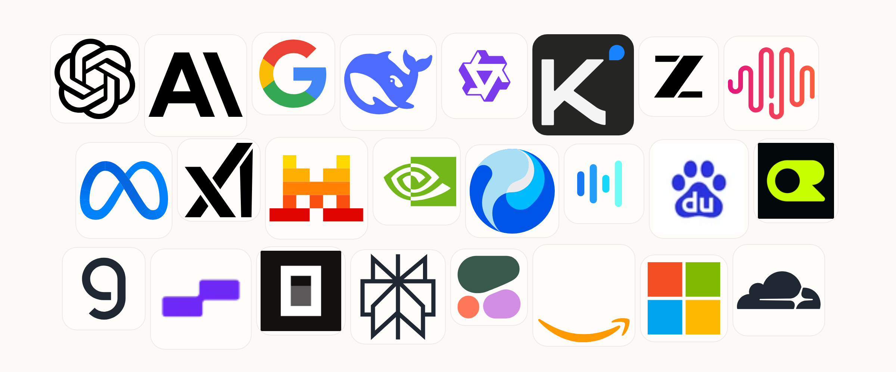
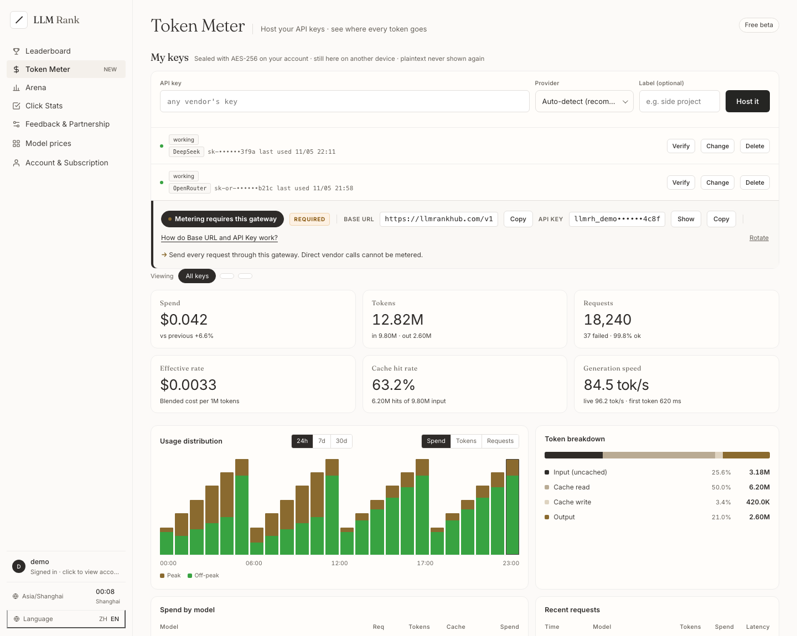
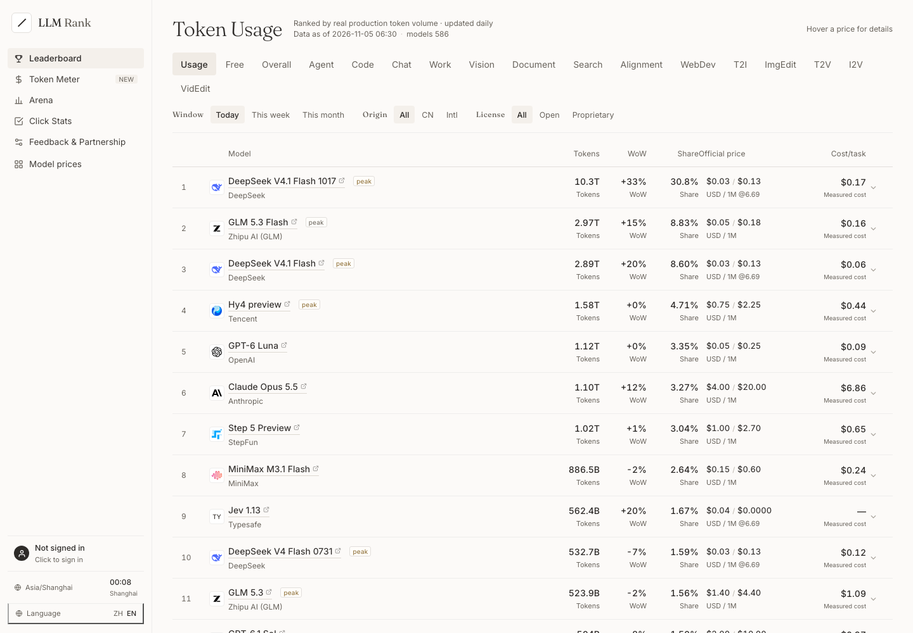
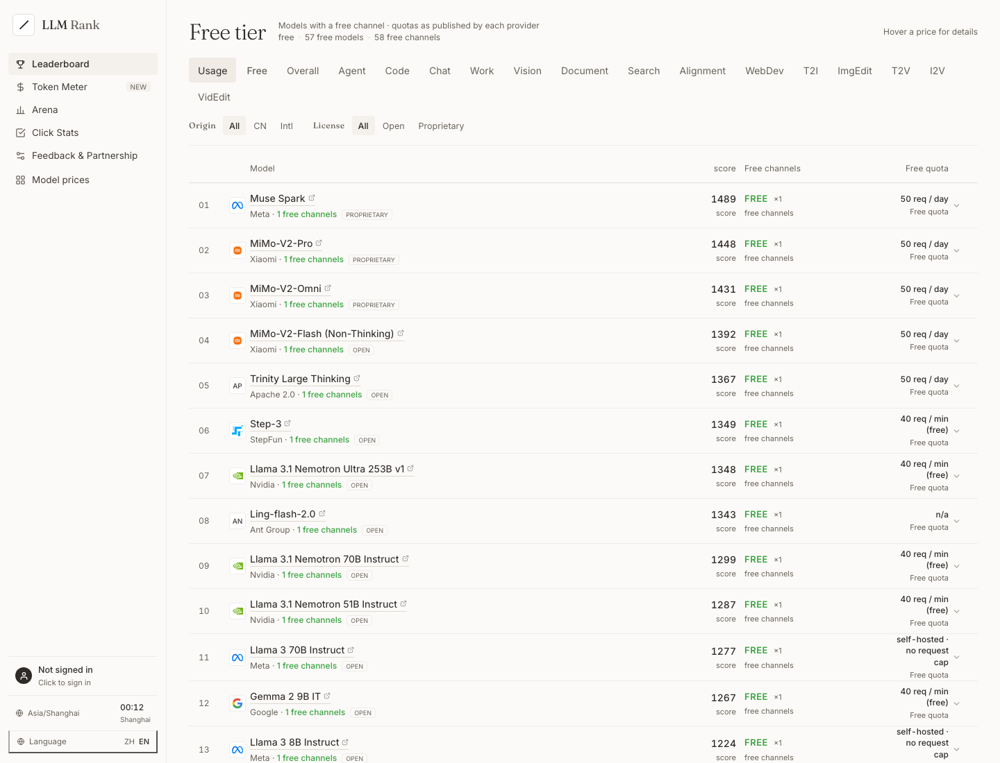

<p align="center"></p>

<p align="center"><sub><a href="README.md">中文</a> · <b>English</b></sub></p>

<h1 align="center">The same model,<br>for less, more reliably.</h1>

<p align="center"><b>Cross-channel pricing · real usage ranking · free quotas · BYOK Token Meter</b></p>

<p align="center"><sub>600+ models · 780+ channels · 130+ free channels · updated daily</sub></p>

<p align="center">
  <a href="https://llmrankhub.com/promo"></a>
  <a href="https://llmrankhub.com"></a>
</p>

<p align="center"><sub>A 30-second intro · or jump straight into the product</sub></p>

<p align="center">
  
</p>

<p align="center"><sub>Selected channels and model vendors · more on the live site</sub></p>

---

LLM Rank Hub is a cross-channel price and real-usage intelligence site for developers.

It puts "who is cheaper, who is more reliable, who still has free quota" into one table — then plugs your real traffic in through a BYOK gateway and shows where every token goes.

> Not another model leaderboard. A procurement and routing desk.

## Exclusive: Token Meter

<p align="center">
  
</p>
<p align="center"><sub>Sample account data · actual values depend on your key</sub></p>

Most price sites stop at the list price. LLM Rank Hub goes one step further: connect your key and see where every token goes from real usage.

- **Key custody**: AES-256-CTR + HMAC. The master key lives outside the database; deleting a key wipes its ciphertext immediately.
- **One gateway, two protocols**: `/v1/chat/completions` and `/v1/messages` both work; point `base_url` here and use an `llmrh_…` token.
- **Real metering**: input / output / cached / reasoning tokens, cost, cache hit rate, TPS, TTFT and per-request events.
- **No content logging**: prompts and replies are relayed in memory only; never written to disk or logs.

```python
from openai import OpenAI

client = OpenAI(
    base_url="https://llmrankhub.com/v1",
    api_key="llmrh_...",
)

resp = client.chat.completions.create(
    model="deepseek-v4.1-flash",
    messages=[{"role": "user", "content": "hello"}],
)
print(resp.choices[0].message.content)
```

## Two boards: real usage + free tiers

<p align="center">
  
</p>

Ranked by real production token volume, with today / this week / this month, plus CN / intl and open / proprietary filters. Expand a model to see per-channel price, uptime and task cost.

<p align="center">
  
</p>

Only models with at least one free channel. Expand one to see **free channels only**, with quotas:

- OpenCode free: `50 req/day`
- OpenRouter `:free`: `20 req/min · 50/1000 req/day`
- Groq free: `30 req/min · daily quota in the console`
- Google AI Studio free: rate limits by model / region; see the official docs

## Data and method

- Every price links back to its source; no source, no number.
- One row per vendor and product line (the cheapest), so plans do not flood the table.
- Free tiers are conservative: zero price plus an explicit free label or a manually verified source; a missing price is never treated as free.
- Real usage ranks by production token volume — not votes, not visits.

## Links

- Promo: [llmrankhub.com/promo](https://llmrankhub.com/promo) · [中文](https://llmrankhub.com/promo/zh)
- Product: [llmrankhub.com](https://llmrankhub.com)
- Feedback & partnerships: [llmrankhub.com](https://llmrankhub.com)

<p align="center"><sub>Built with a single HTML file, Python stdlib, and a lot of price tables.</sub></p>
