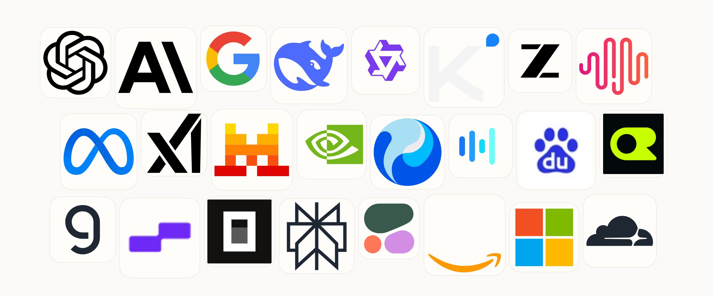
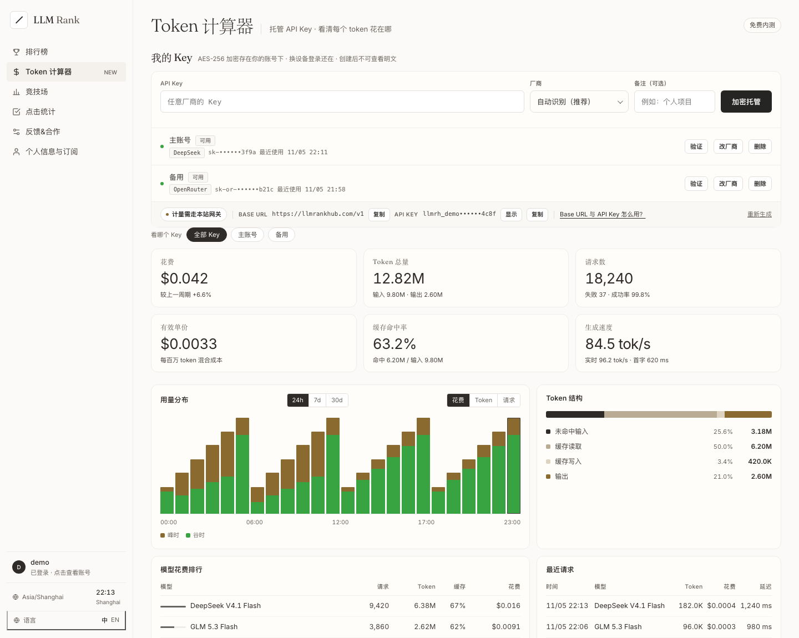
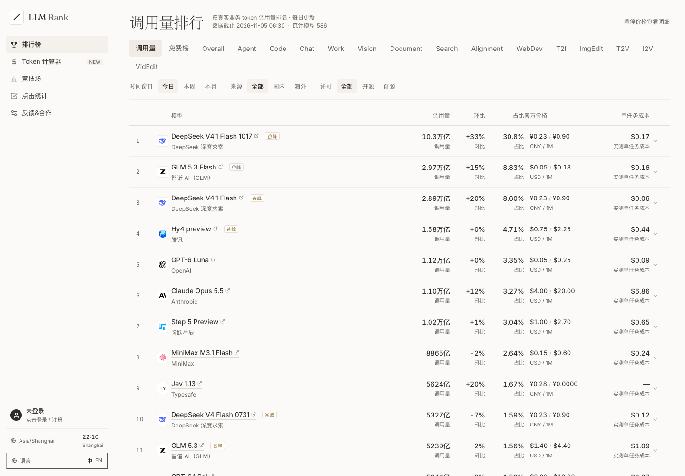
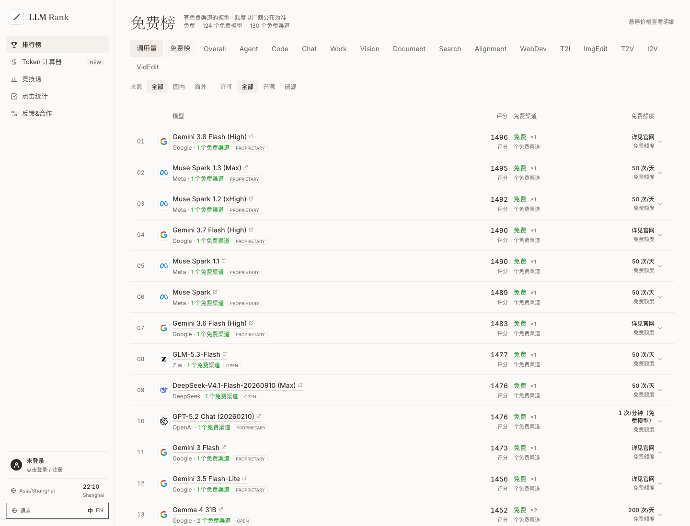

<p align="center"></p>

<h1 align="center">同一个模型，<br>找到更便宜、更稳定的渠道。</h1>

<p align="center"><b>跨渠道比价 · 真实调用量排行 · 免费额度 · BYOK Token 计算器</b></p>

<p align="center"><sub>600+ 模型 · 780+ 渠道 · 130+ 免费渠道 · 每日更新</sub></p>

<p align="center">
  <a href="https://llmrankhub.com/promo"></a>
  <a href="https://llmrankhub.com"></a>
</p>

<p align="center"><sub>先看 30 秒介绍 · 或直接打开产品</sub></p>

<p align="center">
  
</p>

<p align="center"><sub>部分渠道与模型厂商 · 更多见站内</sub></p>

---

LLM Rank Hub 是一个面向开发者的跨渠道模型价格与真实用量情报站。

它把「哪家便宜、哪家稳定、哪家还有免费额度」放在同一张表里，并且用 BYOK 网关把你的真实调用接进来，算出每个 token 到底花在哪。

> 不是又一个模型排行榜，而是采购与路由决策台。

## 独家：Token 计算器

<p align="center">
  
</p>
<p align="center"><sub>示例账号数据 · 实际数值以你的 Key 为准</sub></p>

大多数比价站停在「看一眼价格」。LLM Rank Hub 多做一步：把你的 Key 接进来，用真实调用算出每个 token 的去向。

- **Key 托管**：AES-256-CTR + HMAC，主密钥不在数据库；删除 Key 立即清除密文。
- **一条网关，两种协议**：`/v1/chat/completions` 与 `/v1/messages` 都兼容；把 `base_url` 指过来，令牌用 `llmrh_…`。
- **真实计量**：输入 / 输出 / 缓存 / 推理 token、成本、缓存命中率、TPS、TTFT、逐请求事件。
- **不记录内容**：prompt 和回复只在内存中转发，不落盘、不进日志。

```python
from openai import OpenAI

client = OpenAI(
    base_url="https://llmrankhub.com/v1",
    api_key="llmrh_...",
)

resp = client.chat.completions.create(
    model="deepseek-v4.1-flash",
    messages=[{"role": "user", "content": "hello"}],
)
print(resp.choices[0].message.content)
```

## 两块榜：真实用量 + 免费额度

<p align="center">
  
</p>

按真实生产 token 调用量排名，支持今日 / 本周 / 本月，以及国内 / 海外、开源 / 闭源筛选。每个模型展开后是逐渠道价格、可用率与任务成本。

<p align="center">
  
</p>

只收录至少有一个免费渠道的模型。展开后**只显示免费渠道**，并标注额度：

- OpenCode 免费：`50 次/天`
- OpenRouter `:free`：`20 次/分 · 50/1000 次/天`
- Groq 免费：`30 次/分 · 日额度见控制台`
- Google AI Studio 免费：按模型 / 地区限流，额度以官方为准

## 数据与方法

- 每条价格都能点回来源；没有来源的数字不展示。
- 同厂商同产品线只保留最低价，避免套餐刷屏。
- 免费渠道采用保守判定：零价 + 明确免费标识 / 手工核验来源；不把缺失价格当成免费。
- 真实调用量按生产环境 token 量排名，不是投票，也不是访问量。

## 链接

- 宣传页：[llmrankhub.com/promo](https://llmrankhub.com/promo)
- 产品：[llmrankhub.com](https://llmrankhub.com)
- 反馈与合作：[llmrankhub.com](https://llmrankhub.com)

<p align="center"><sub>Built with a single HTML file, Python stdlib, and a lot of price tables.</sub></p>
